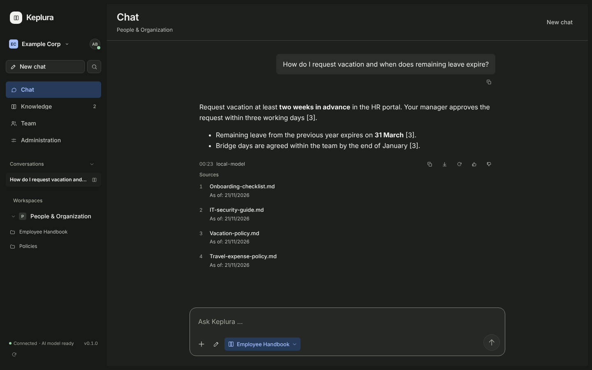
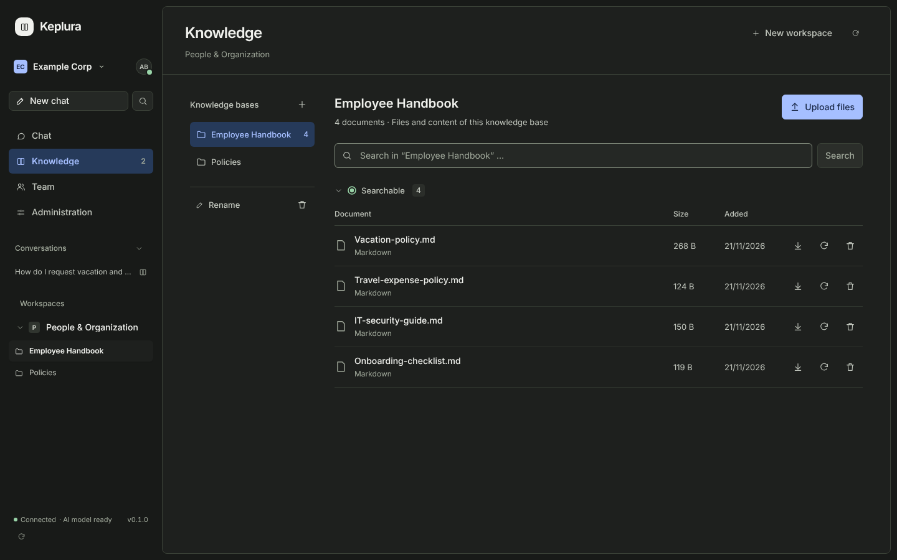
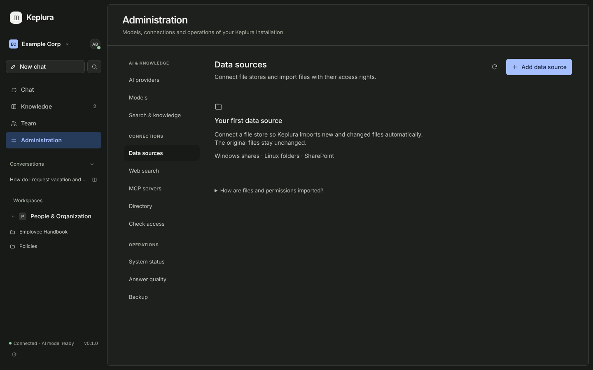
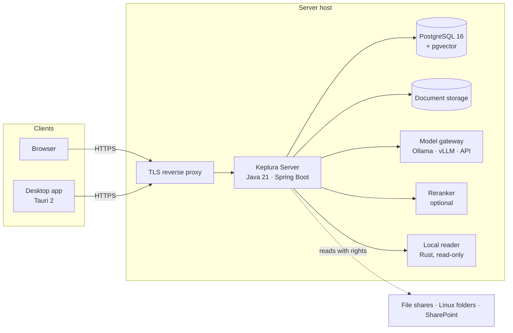

# Keplura

**Self-hosted AI assistant for your company's own documents.** Keplura answers
questions from your files with source citations. Each person sees only what
they are already allowed to read in the original file share. Everything runs
on your own server, with a local language model if you want one, so documents
and questions stay in-house.

> **Status: pre-release (0.x).** Keplura is under active development and has
> not reached a beta release yet. Run it as a pilot or for evaluation, not as
> your only copy of important data. See [Known limitations](#known-limitations).
>
> The user interface is available in **English and German**. It follows the
> system language; switch it in the account menu or on the sign-in screen.



<sub>Screenshots use fictitious sample data. Retrieval and citations are real.
The model answer in the chat screenshot was streamed from a local stand-in, not
a real language model. Recreate them with `desktop/e2e/readme_screenshots.cjs`.</sub>

## What Keplura does

- **Chat with your documents.** Answers come with numbered sources, the file's
  last-changed date and a preview of the cited passage.
- **Permission-aware search.** Data sources (Windows/SMB shares, Linux folders,
  SharePoint) are imported together with their access rights. Search and chat
  only use documents the asking person may open at the source.
- **Your model, your hardware.** Ollama (CPU), vLLM (GPU) or any
  OpenAI-compatible API, configured on the server. API keys never reach the
  client.
- **Document types.** Text, Markdown, CSV, PDF, Word, Excel and PowerPoint;
  scanned PDFs through local OCR (Tesseract, German and English).
- **Organisations, workspaces, knowledge bases.** Multi-tenant on one server,
  with OWNER/MEMBER roles, invitations, and local accounts, LDAP/Active
  Directory or OIDC single sign-on.
- **Optional extras.** Web search, MCP tool servers and an "oversharing check"
  that flags broadly readable or sensitive-looking files before import.
- **Operations included.** One-command installer, backup/restore scripts,
  health endpoint, answer-quality check.

| Knowledge bases | Administration |
|---|---|
|  |  |

## Architecture



- **Server** (`server/`): Java 21, Spring Boot 4.1, Maven, organised as a
  modular monolith. It is the only trusted component. It enforces tenant
  isolation and document permissions on every query and holds all secrets.
- **Web UI and desktop app** (`desktop/`): one Vue 3 + TypeScript code base.
  The server delivers it to browsers; Tauri 2 packages it as a native app for
  Windows, macOS and Linux. Clients are treated as untrusted.
- **API contract**: [`contracts/openapi.yaml`](contracts/openapi.yaml) (REST/JSON,
  SSE for streaming answers).
- **Deployment** (`deploy/`): Docker/Podman Compose stack, installer, operator
  tools. **Scripts** (`scripts/`): backup, restore, local CI.
- Architecture decisions are recorded in [`docs/adr/`](docs/adr/).

## Quick start

### Try it on a Linux server (recommended)

Needs Linux x86_64, Docker or Podman with Compose, `git` and `openssl`; at
least 16 GB RAM for the default 7B model on CPU (see
[hardware](docs/OPERATIONS.md#hardware-requirements)).

```bash
git clone https://github.com/marcello-conocchia/Keplura.git /opt/keplura
cd /opt/keplura/deploy
./install.sh --admin-email admin@example.com
```

The installer generates all secrets into `deploy/.env.production` (mode 600),
builds the server image, starts PostgreSQL + pgvector and Ollama, downloads
the chat model (`qwen2.5:7b`) and embedding model (`bge-m3`), and waits until
`http://127.0.0.1:8080/api/v1/health` reports `UP`. The first admin password
is only written to `.env.production` and never printed.

For production put a TLS reverse proxy in front: session cookies are `Secure`,
so a plain-HTTP login only works from the same machine. Full guide,
including updates: **[docs/INSTALL.md](docs/INSTALL.md)**.

### Develop locally

Needs JDK 21, Maven 3.9+, Node.js 22 (20.19+ works), and for the desktop shell Rust stable
plus the [Tauri prerequisites](https://v2.tauri.app/start/prerequisites/).

```bash
# Server (dev profile, H2 database, one seeded account)
cd server
mvn -B package -DskipTests
java -jar target/keplura-server-0.1.0.jar \
  --keplura.dev.seed.email=dev@example.com \
  --keplura.dev.seed.password='choose-a-dev-password' \
  --keplura.dev.seed.display-name='Dev User'

# Web UI on http://localhost:1420 (second terminal)
cd desktop
npm ci
npm run dev

# Optional: native desktop window
npm run tauri dev
```

Without a configured model the chat cannot answer; point
`KEPLURA_GATEWAY_BASE_URL` at an Ollama or other OpenAI-compatible endpoint
(see [`.env.example`](.env.example)). Details, tests and the PostgreSQL setup:
[docs/development.md](docs/development.md) and
[CONTRIBUTING.md](CONTRIBUTING.md).

## Documentation

| Topic | Where |
|---|---|
| Installation, first login, updates | [docs/INSTALL.md](docs/INSTALL.md) |
| Operations, hardware, monitoring, backup, known limitations | [docs/OPERATIONS.md](docs/OPERATIONS.md) |
| Detailed operator guide (German) | [deploy/README.md](deploy/README.md) |
| Development guide (build, test, architecture details) | [docs/development.md](docs/development.md) |
| Contributing, tests and PR process | [CONTRIBUTING.md](CONTRIBUTING.md) |
| Reporting security issues | [SECURITY.md](SECURITY.md) |
| Release process | [docs/RELEASING.md](docs/RELEASING.md) |
| Changes | [CHANGELOG.md](CHANGELOG.md) |
| Configuration reference | [`.env.example`](.env.example), [`deploy/.env.production.example`](deploy/.env.production.example) |
| SharePoint, MCP how-tos | [docs/howto/](docs/howto/) |
| Architecture decisions | [docs/adr/](docs/adr/) |
| Roadmap and project state | [docs/ROADMAP.md](docs/ROADMAP.md), [docs/PROJECT_STATE.md](docs/PROJECT_STATE.md) |
| Third-party licenses | [docs/legal/THIRD_PARTY_LICENSES.md](docs/legal/THIRD_PARTY_LICENSES.md) |

Much of the internal engineering documentation (ADRs, task specs, review
reports) is written in German. Development before November 2026 happened in a
private repository: pull request numbers up to #95 and evidence paths under
`ci/evidence/` mentioned in older documents refer to that archive.

## Known limitations

- Pre-release software: no stable release, no long-term support promise yet.
- Server messages (errors, sync and check results) are still German in the
  English interface.
- One server instance. Sessions are held in server memory, so a restart signs
  everyone out (no data loss). No high-availability setup.
- The desktop app gets its server URL at build time (`VITE_SERVER_URL`).
  Windows and macOS packages are not code-signed or notarised.
- The web UI has no global Content-Security-Policy yet.
- NFS sources are blocked for now; OCR covers German and English.

The full list is in [docs/OPERATIONS.md](docs/OPERATIONS.md#known-limitations).

## Free software, optional services

Keplura is meant to be free to use, with no paid edition, feature gates or
usage limits. If you want help, independent companies (including the
maintainer) can offer paid installation, integration with your systems,
maintenance and support. Those services are optional; the software and its
documentation are complete without them.

## License

Keplura is licensed under the [Apache License 2.0](LICENSE); see also
[NOTICE](NOTICE). You may use, modify and redistribute it, including
commercially, under the terms of that license. Third-party components keep
their own licenses, listed in
[docs/legal/THIRD_PARTY_LICENSES.md](docs/legal/THIRD_PARTY_LICENSES.md).

The license covers the code, not the name: it grants no rights to use the
"Keplura" name or logo (Apache License 2.0, section 6).


